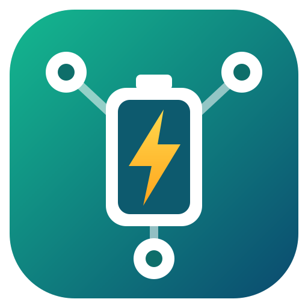

  

<h1 align="center">GivEnergy Gateway Modbus Coms</h1>

  
  
  
  
   
  
  
  
  
  

  
  

Local Home Assistant integration for GivEnergy inverters, All-in-One (AIO) and Gateway over the LAN, with no cloud and no GivTCP container. You type in an IP address and port. The integration probes the device, works out what it is, checks which register blocks it actually answers, and creates entities only for those blocks.

Built in the same shape as [HA-Sofar-Modbus](https://github.com/mimikm/HA-Sofar-Modbus).

> **Beta.** Reading is the main focus. Controls are limited to an allow-list of registers (see below). Check every control on your own hardware before you hand it to automations or Predbat.

## Supported devices

| Device | Detected as | Live data | Controls |
|---|---|---|---|
| Hybrid Gen 1 / 2 / 3 / 4 | `hybrid` | ✅ IR 0-59, 180-239 | ✅ |
| AC coupled | `ac` | ✅ | ✅ + pause mode, power % |
| All-in-One | `aio` | ✅ | ✅ + pause mode, power %, 10-slot map |
| Gateway | `gateway` | ✅ IR 1600-1859 (grid, PV, load, AIO 1-3) | ✅ via HR 0-299, if the Gateway answers them |
| LV battery packs (0x32-0x37) | per-pack device | ✅ SOC, V, A, temps, cycles, capacity, 16 cell voltages | — |
| 3-phase, EMS | `three_phase` / `ems` | ⚠️ probe and raw reads only | — |

The device type comes from HR 0 (the device type code). For hybrids, HR 21 (ARM firmware) tells Gen 1, 2 and 3 apart.

## Important: one client per dongle

A GivEnergy dongle or Gateway serves **one TCP client at a time** on port 8899. If GivTCP, another integration or a local-mode app is connected, the probe fails or the responses get mixed up. **Stop GivTCP for any device you add here.** You can keep GivTCP running for your other devices.

## Install

### HACS (recommended)

1. Click **Open in HACS** above. Or in HACS open ⋮ → **Custom repositories**, add `https://github.com/mimikm/GivEnergy-Gateway-Modbus-Coms-` with category **Integration**.
2. Download **GivEnergy Gateway Modbus Coms** and restart Home Assistant.
3. Click **Add integration** above, or go to Settings → Devices & services → Add integration → **GivEnergy Gateway Modbus Coms**.
4. Enter the IP address and port (default **8899**). The integration probes the device.
5. Choose a device name, and pick which of the four sections to poll and how often (see below).

### Manual

Download `givenergy_modbus.zip` from the [latest release](https://github.com/mimikm/GivEnergy-Gateway-Modbus-Coms-/releases/latest), unzip it into `/config/custom_components/givenergy_modbus/`, then restart Home Assistant.

Add each dongle or Gateway as a separate entry. A Gateway and the AIO behind it are two separate entries.

## Sections: four devices, polled the way you choose

Entities are split into four groups. Each group is its own device in Home Assistant:

| Device | Section | What's in it | Default poll |
|---|---|---|---|
| **GivEnergy Gateway Power** | Power | Live power flows (W): grid, PV, load, battery/AIO, plus SOC | 10 s |
| **GivEnergy Gateway Energy** | Energy | Today and lifetime kWh counters, ready for the Energy dashboard | 60 s |
| **GivEnergy Gateway Controls** | Controls | Battery mode, enables, SOC targets, reserve, rate limits, pause mode, slot times | 60 s |
| **GivEnergy Gateway** | System | Status, voltages, currents, frequency, temperatures, faults, firmware, the Re-probe button, and battery packs (*GivEnergy Gateway Battery 1…*) | 30 s |

- The device name ("GivEnergy Gateway" above) is yours to choose. It's the prefix for all four devices and their entity IDs, e.g. `sensor.givenergy_gateway_power_grid_power`.
- Each section can be **turned off**. A section that's off is **not polled at all**: only the register blocks the enabled sections need are read. Its entities and its device are removed.
- Each section has its **own poll interval** (5–3600 s). For example, Power every 5 s for a live dashboard, Energy every 5 minutes.
- You can change all of this later under **Settings → Devices & services → GivEnergy Gateway Modbus Coms → Configure**. Saving reloads the integration.
- Entities keep their unique IDs when you change sections, so history and dashboards survive.
- The same **Configure** window has two tick-boxes for re-reading the device:
  - **Re-read device registers on save**: re-detects the model, firmware, register blocks and battery packs, then rebuilds the entities. Use it after a firmware update or after adding a battery.
  - **Run full register scan now**: sweeps every known register range (up to about a minute) and posts a results table as a notification.

## How probing works

1. The integration reads HR 0-59 at device address `0x11`. If that fails, it retries at `0x31`, which some Gen 1 and AC units use.
2. It decodes the model, serial and firmware.
3. It tries each candidate block: IR 0, IR 180, HR 60, HR 120, HR 240 (10-slot map), HR 300 (AC/AIO config) and, for a Gateway, IR 1600-1859. It only polls the blocks that answer.
4. For hybrid and AC models it scans battery addresses 0x32 upwards until it finds a pack with no valid serial.

Press **Re-probe registers** on the device page to run the probe again, for example after a firmware update.

### Probe service (for mapping unknown devices)

`givenergy_modbus.probe_registers` sweeps every known range: IR 0-359, 1000-1359, 1600-1859, 2040; HR 0-359, 499, 540, 1000, 2040, 4080, 20000; battery, BMU and BCU addresses. It shows a table of what answered as a notification and returns the raw values as the service response.

`givenergy_modbus.read_registers` reads any 1-60 registers at any device address and returns them as a service response. Use it in Developer tools → Actions.

**Download diagnostics** on the integration gives a full register dump. Attach it to an issue if something decodes wrongly.

## Entities

**Inverter / AIO**: status, PV1/PV2 V/A/W, PV power, grid voltage and frequency, grid power (+export / −import), grid import power, grid export power, load, EPS, battery power (+discharge), battery charge power, battery discharge power, SOC, battery V/A, temperatures, fault and warning codes, plus today and lifetime energy (PV, import, export, AC charge, battery charge and discharge, inverter output).

**Gateway**: grid V/A/W, PV, load, Liberty power, AIO total power, AIO charge power, AIO discharge power, per-AIO SOC and power, and today and lifetime energy for import, export, PV, load, AIO and battery. Lifetime totals handle the word-order swap between Gateway firmware V1 and V2 automatically.

**Battery pack**: SOC, voltage, current, min and max temperature, cycles, remaining and full capacity (Ah), remaining energy (kWh), and cell voltages (disabled by default).

### Controls

| Entity | Register(s) | Notes |
|---|---|---|
| Battery mode (select) | HR 27 + HR 59 | Eco / Timed Demand / Timed Export, same as GivTCP |
| Eco mode, Discharge enable, AC charge enable, Charge target enable | HR 27, 59, 96, 20 | switches |
| Charge target SOC | HR 116 | 4-100 % |
| Charge slot 1 target SOC | HR 242 | 10-slot devices only |
| Battery SOC reserve / power cutoff SOC | HR 110 / HR 114 | 4-100 % |
| Charge / discharge rate limit | HR 111 / HR 112 | raw 0-50 |
| Charge / discharge power percent | HR 313 / HR 314 | AC, AIO and Gateway only |
| Battery pause mode | HR 318 | AC, AIO and Gateway only |
| Charge slot 1 start/end | HR 94 / 95 | time entities |
| Discharge slot 1 start/end | HR 56 / 57 | |
| Charge slot 2 start/end | HR 31/32, or HR 243/244 on 10-slot devices | |
| Discharge slot 2 start/end | HR 44/45, or HR 273/274 on 10-slot devices | |

After every write, the integration reads the register block back, so the entity shows what the inverter actually stored. `write_register` refuses any register not in this table.

## Protocol notes

GivEnergy dongles do **not** use standard Modbus TCP. Each request is wrapped in a `0x5959` header with the adapter serial and an 8-byte padding field, followed by the inner Modbus PDU and a CRC-16/Modbus. Replies include the inverter serial. Reads are limited to 60 registers. The dongle sends a heartbeat about every 3 minutes and drops the link unless the client echoes it within about 5 s. The client here runs a background reader that echoes heartbeats, keeps one request in flight with a 0.25 s gap between requests, and caches the data the inverter pushes on its own.

## Development and releases

- `.github/workflows/validate.yml` runs the HACS action, Home Assistant's hassfest and the test suite on every push.
- `.github/workflows/release.yml` runs when a GitHub release is published. It stamps the tag version into `manifest.json`, builds `givenergy_modbus.zip` and attaches it to the release, and HACS installs that zip. Release assets are what the download counters count.
- `scripts/release.sh 0.1.2` bumps the version, tags, pushes and creates the release (the last step needs the GitHub CLI).
- Run the tests locally with `pip install pytest && pytest -q tests`.

The integration icon is in `custom_components/givenergy_modbus/brand/`. Home Assistant 2026.3 and later show it automatically.

## Support the project

If this integration saves you some hassle, you can support it here:

- ☕ **[Buy me a coffee](https://buymeacoffee.com/mimikm)**
- 🐙 **Switching to Octopus Energy?** Use my referral link at **[octopusreferralcode.com](https://octopusreferralcode.com)**. We both get account credit.

## Credits

The register maps and protocol details come from [dewet22/givenergy-modbus](https://github.com/dewet22/givenergy-modbus) and the GivTCP async fork by britkat1980. This integration has its own small client and doesn't depend on either library.

## Disclaimer

Not affiliated with GivEnergy. Writing registers changes how your inverter behaves, so use the controls at your own risk.
